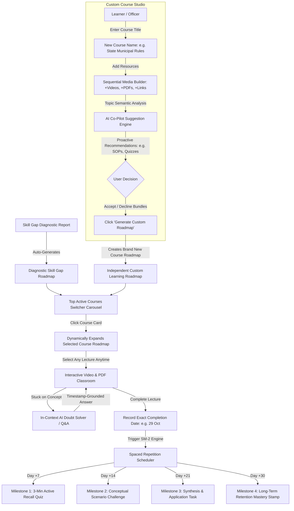

# DAKSH Dynamic AI Learning Hub — System Design & Stitch UI Prompts

> **Document Version:** 2.0.0  
> **Target Platform:** DAKSH Capacity Building & Intelligent Upskilling Ecosystem  
> **Focus:** Dynamic Non-Linear Roadmaps, Custom Resource Management, AI Co-Pilot Suggestions, 7-14-21-30 Day Spaced Repetition Engine, and In-Video Contextual Q&A  
> **Primary Use-Case:** System Architecture Specification & Ready-to-Paste Prompts for Google Stitch / AI UI Generators (v0, Figma AI, Lovable, Bolt)

---

## 1. Executive Summary & Core Philosophy

The **DAKSH AI Learning Hub** evolves the traditional rigid, linear LMS into an **autonomous, adaptive learning ecosystem**. While the foundation is calibrated automatically from the user's **Skill Gap Diagnostic Report**, learners are not trapped in a monolithic sequence. 

### Key Pillars:
1. **Dynamic & Non-Linear Navigation:** Learners can freely explore, watch, and switch between any course videos or modules on-demand without artificial lockouts, while retaining clear completion telemetry.
2. **Dual-Path Curriculum Ingestion (Skill-Gap Generated + Custom Course Roadmap Studio):** Beyond automated gap-filling courses, users can **build their own independent custom courses and learning roadmaps from scratch**. A learner gives the course a name (e.g., *"State Municipal Rules & Treasury Operations"*), adds multiple video lectures, PDFs, and links sequentially under it, optionally bundles proactive AI co-pilot suggestions, and clicks **"Generate Roadmap"**. This compiles into a dedicated, self-contained learning roadmap in their top course selector.
3. **Proactive AI Co-Pilot (Human-in-the-Loop):** Whenever a user creates a course or studies a topic, the AI co-pilot analyzes the context and suggests high-yield supplementary materials (e.g., standard operating procedures, practice checklists, video deep-dives). The user retains 100% agency to accept or dismiss with one click.
4. **Timestamped Completion & Scientific Spaced Repetition (7, 14, 21, 30 Days):** Completing a video module marks an immutable timestamp (e.g., *29 October*). The system schedules automated active-recall intervals at **Day +7, Day +14, Day +21, and Day +30** backed by the SuperMemo SM-2 algorithm to defeat the Ebbinghaus forgetting curve.
5. **In-Video Contextual AI Tutor & Doubt Solver:** An interactive, timestamp-aware AI sidekick embedded alongside the video player that answers specific queries grounded directly in the video lecture's transcript and attached notes.

---

## 2. Complete User Journey & System Workflow



---

## 3. Deep-Dive Feature Specifications

### 3.1. Dynamic Course Switcher & On-Demand Roadmap Explorer
* **Top Active Courses Switcher (Carousel / Tab Bar):**
  - Positioned prominently across the top of the hub, displaying all enrolled or active courses (e.g., *Course 1: GFR 2017 & GeM Bidding*, *Course 2: Cyber Hygiene & IT Governance*, *Course 3: Treasury Accounting & Audit*).
  - Each course card in this top bar displays:
    - Course Title & Category Badge
    - Circular Progress Ring or Micro-Progress Bar (e.g., `68% Completed`)
    - Next Upcoming Lecture Badge & Duration
    - Active / Selected Indicator with subtle glow border
* **Click-to-Expand Dynamic Roadmap:**
  - When the user clicks or selects any course from the top carousel, the main canvas below **instantly and dynamically updates to unfold that specific course's full personalized learning roadmap**.
  - Displays the multi-stage curriculum tree (Stage 01: Core Foundations → Stage 02: Bidding Workflows → Stage 03: Scenario Quiz → Stage 04: Advanced SOPs).
* **On-Demand Freedom (No Linear Lockouts):** 
  - Even within an expanded roadmap, the learner is not artificially locked into sequential order. Users can jump forward to urgent topics on-demand while telemetry tracks progress accurately.
* **Progress & Telemetry:** Every module and video lecture tracks:
  * `progress_percent` (0% to 100%)
  * `watch_time_seconds`
  * `status` (`not_started`, `in_progress`, `completed`)
  * `last_accessed_at`
* **Badge Indicators:** Visual chips distinguish between `[AI Gap Recommendation]` and `[Custom Officer Added]`.

### 3.2. Custom Course & Roadmap Builder Studio (Multi-Resource Creation Flow)
Rather than merely uploading isolated files, the user can create a **brand new dedicated Course & Learning Roadmap**:

1. **Course Identity Definition:**
   - The user enters a **Course Name** (e.g., *"State Municipal Tax Administration & Auditing"*).
   - Selects or tags a target competency area (e.g., *Urban Governance & Revenue*).
   - Sets an optional target completion timeframe or difficulty tier.

2. **Sequential Multi-Item Curriculum Builder:**
   Under the course name, the user builds out the syllabus by adding multiple learning assets in sequence:
   * **`[+ Add Video Lecture]`**: Input YouTube link, Vimeo URL, or direct MP4 stream + Lecture Title (e.g., *"Lesson 01: Property Assessment Workflow"*) + Duration.
   * **`[+ Add PDF Document]`**: Upload PDF or input circular link (e.g., *"Gazette Notification on Municipal Tax Revision 2026"*).
   * **`[+ Add External Reference]`**: Link to government portals, guidelines, or e-governance systems.
   * Learners can reorder, rename, or delete items before final compilation.

3. **In-Studio AI Co-Pilot Recommendation (Smart Bundling):**
   - As the user types the Course Title and adds items, SETU AI analyzes the topic semantically.
   - Proactive suggestion drawer pops up:
     > *"💡 SETU AI Co-Pilot: For 'State Municipal Tax Administration', we found the official 'State_Property_Tax_Compendium.pdf' and can auto-generate a 5-question scenario quiz. Would you like to bundle these into this new roadmap?"*
   - The user has complete control: check or uncheck the suggested assets.

4. **Roadmap Generation & Hub Integration:**
   - Clicking **`[🚀 Generate Custom Learning Roadmap]`** compiles all the added videos, PDFs, and accepted AI bundles into a **new, independent course roadmap**.
   - This new course immediately appears as a selectable card in the **Top Active Courses Switcher Carousel** (e.g., *"[COURSE 04: Municipal Tax Administration (Officer Curated)]"*).
   - Clicking on this course card at the top instantly expands its personalized multi-stage roadmap, complete with video progress tracking and automated 7-14-21-30 day spaced repetition triggers.

### 3.3. AI Co-Pilot Recommendation Engine
* **Trigger:** When a user attaches a resource (or marks a video in progress), the background LLM extracts the core competency vector.
* **Recommendation Display:** A non-intrusive, dismissible **AI Suggestion Pill / Floating Card**:
  > *"💡 AI Recommendation: Since you added 'Python Data Analysis for Audit Reports', would you like to include the official 'Pandas Performance Cheat Sheet' and a 5-minute practical lab?"*
* **Controls:** 
  * `[+ Add to My Hub]` (Instantly appends with XP rewards)
  * `[Preview Resource]` (Opens a slide-over modal)
  * `[Dismiss]` (Silently dismisses without nag)

### 3.4. Timestamped Spaced Repetition Retention Engine (7-14-21-30 Days)
* **Completion Event:** The exact instant a video lecture reaches $\ge 90\%$ playback or the user marks it finished, an immutable log entry is generated:
  * `completed_at`: `2026-10-29T18:25:00+05:30`
* **Cadence Milestones:**
  1. **Day +7 (Retention Radar 1):** Rapid 3-question active recall card. Target: Reinforce initial retention before standard 80% memory drop.
  2. **Day +14 (Retention Radar 2):** Scenario-based micro-problem. Target: Transfer from short-term memory to applied knowledge.
  3. **Day +21 (Retention Radar 3):** Edge-case analysis & synthesis card. Target: Deep cognitive consolidation.
  4. **Day +30 (Retention Radar 4):** Master Checkpoint. Successfully answering awards the **"Permanent Memory Verified"** badge and updates the officer's competency profile.
* **SuperMemo SM-2 Feedback Loop:**
  * Rating buttons after review: `Again (0-2)`, `Hard (3)`, `Good (4)`, `Easy (5)`.
  * If failed (`< 3`), reset interval to Day +1; if passed, ease factor adapts.

### 3.5. In-Video AI Doubt Solver & Contextual Q&A
* **Layout:** Dual-pane or collapsible right-hand drawer during video playback.
* **Video Context Sync:** The AI knows the exact current playback timestamp (e.g., `04:42`) and the video's transcript/syllabus.
* **Quick Action Prompt Chips:**
  * ⏱️ *"Explain what was said in the last 60 seconds"*
  * 📋 *"Generate 3 flashcards from this lecture"*
  * 🔍 *"Summarize key compliance rules mentioned here"*
  * 💡 *"Give me a practical real-world government example"*
* **Socratic Dialogue:** Explains complex terms simply without spoon-feeding answers during quizzes.

---

## 4. UI/UX Wireframe & Screen Architecture

### Screen 1: Learning Hub Main Dashboard & Dynamic Roadmap Explorer

```
+-------------------------------------------------------------------------------------------------------------------------+
| [DAKSH]  Home | Skill Gap | Learning Hub (Active) | Interview Room | Settings                             [Officer Amit] |
+-------------------------------------------------------------------------------------------------------------------------+
|                                                                                                                         |
|  [⚡ Memory Retention Alert] 2 Concepts Due for Day +7 Review Today!                      [Start Rapid Review (3 min)]  |
|                                                                                                                         |
|  AI LEARNING HUB & ADAPTIVE CURRICULUM                                                    [+ Add Custom Resource]       |
|  Personalized path for Gazetted Finance Officer | 4 Enrolled Courses | 18 Lectures                                      |
|                                                                                                                         |
|  +-- TOP ACTIVE COURSES SWITCHER (Click any course to load its dynamic roadmap) -------------------------------------+  |
|  |  +-----------------------------+  +-----------------------------+  +-----------------------------+               |  |
|  |  | [ACTIVE / SELECTED] ★       |  | [COURSE 02]                 |  | [OFFICER CURATED]           |  [+ Browse   |  |
|  |  | Public Procurement & GeM    |  | Cyber Hygiene & IT Act      |  | State Treasury Rules 2026   |    More]     |  |
|  |  | Progress: [========  ] 68%  |  | Progress: [====      ] 30%  |  | Progress: [==========] 100% |              |  |
|  |  | Next: Lecture 04 (In-prog)  |  | Next: Lecture 02            |  | Completed: 29 Oct (Day +7)  |              |  |
|  |  +-----------------------------+  +-----------------------------+  +-----------------------------+               |  |
|  +-------------------------------------------------------------------------------------------------------------------+  |
|                                                                                                                         |
|  +-- AI Co-Pilot Suggestion Banner ----------------------------------------------------------------------------------+  |
|  | 🤖 AI CO-PILOT: Based on your current selection "Public Procurement & GeM", we found 1 high-yield                 |  |
|  |    Official GeM Circular & 1 Practice Quiz. Would you like to append it?             [+ Add to Hub] [Dismiss]     |  |
|  +-------------------------------------------------------------------------------------------------------------------+  |
|                                                                                                                         |
|  +-- DYNAMICALLY EXPANDED ROADMAP FOR: "Public Procurement & GeM Bidding" -------------------------------------------+  |
|  |  Overview: 6 Modules | 4 Video Lectures | 2 PDFs | Total Time: 3h 15m | Progress: 68%                                |
|  |                                                                                                                       |
|  |  [STAGE 01: REGULATORY FOUNDATIONS] (Completed)                                                                      |
|  |  ├─ [✔ VIDEO] Lecture 01: History of GFR & Delegation of Financial Power (24 min) - Done 29 Oct (Day +7 Due) [Review]|
|  |  └─ [✔ PDF] GFR 2017 Gazette Compendium (18 Pages) - Read & Verified [View PDF]                                      |
|  |                                                                                                                       |
|  |  [STAGE 02: GEM BIDDING & REVERSE AUCTION] (Currently In Progress - Watch Anytime)                                   |
|  |  ├─ [▶ VIDEO] Lecture 03: Rule 149 Direct Purchase & L1 Thresholds (28 min - 70% watched)     [▶ Continue Watching]  |
|  |  ├─ [▶ VIDEO] Lecture 04: Reverse Auction Mechanics & OEM Validation (22 min - Available)       [▶ Start Lecture]   |
|  |  └─ [📄 CUSTOM PDF] Officer Added: State Department GeM Tender SOP (6 Pages)                           [📄 Read]     |
|  |                                                                                                                       |
|  |  [STAGE 03: ADAPTIVE COMPETENCY ARENA] (Available Anytime)                                                          |
|  |  └─ [⚡ QUIZ] Dynamic Scenario Assessment: 5 Realistic Procurement Cases (15 min • 100 XP)               [⚡ Start]  |
|  |                                                                                                                       |
|  |  [STAGE 04: ADVANCED DISPUTE SETTLEMENT & AUDIT ESCALATION] (Available Anytime)                                     |
|  |  └─ [▶ VIDEO] Lecture 05: CAG Audit Objections & Rectification Protocol (32 min)                       [▶ Start]   |
|  +-------------------------------------------------------------------------------------------------------------------+  |
+-------------------------------------------------------------------------------------------------------------------------+
```

---

### Screen 2: Interactive Video Classroom with In-Context AI Doubt Solver

```
+---------------------------------------------------------------------------------------------------------+
| [< Back to Hub]  Lecture 03: General Financial Rules (GFR) 2017 Bidding Norms         [+ Add Bookmark]  |
+---------------------------------------------------------------------------------------------------------+
|                                                                         |                               |
|   +-- Left 65%: Video Player & Embedded Viewer ----------------------+  |  +-- Right 35%: SETU AI ----+ |
|   |                                                                  |  |  | 🤖 In-Video AI Assistant | |
|   |                         [▶ VIDEO PLAYER]                         |  |  | Context: GFR 2017 @04:22 | |
|   |                         04:22 / 24:18                            |  |  +-------------------------+ |
|   |                                                                  |  |  | User:                   | |
|   |  [Play] [Seek: =====O============] [1.0x] [CC] [Full Screen]     |  |  | What are the limits for  | |
|   +------------------------------------------------------------------+  |  | single-source bidding?   | |
|                                                                         |  |                             |
|   +-- Tab Navigation ------------------------------------------------+  |  | SETU AI:                 | |
|   | [Overview]   [Attached PDFs (2)]   [Key Timestamps]   [Notes]    |  |  | Under Rule 166 of GFR    | |
|   +------------------------------------------------------------------+  |  | 2017, single-source      | |
|   | • Rule 149: Mandatory GeM Procurement thresholds                  |  |  | procurement applies when | |
|   | • Completed on: 29 Oct 2026 | Next Spaced Review: Day +7 (5 Nov) |  |  | only one OEM exists or   | |
|   | • Attached: "GFR_2017_Compendium.pdf" [Download / View PDF]      |  |  | during urgent emergency. | |
|   +------------------------------------------------------------------+  |  | Ref: Video timestamp 3:45| |
|                                                                         |  +-------------------------+ |
|   [✔ Mark Lecture Completed] -> Triggers Day 7, 14, 21, 30 Cadence       |  | [Ask AI about video...] [^]|
+---------------------------------------------------------------------------------------------------------+
```

---

### Screen 3: "Create Custom Course & Roadmap Builder Studio" Modal

```
+----------------------------------------------------------------------------------------------------+
|  CREATE CUSTOM COURSE & ROADMAP BUILDER                                                        [X] |
+----------------------------------------------------------------------------------------------------+
|                                                                                                    |
|  1. COURSE IDENTITY & META                                                                         |
|  Course Title:                                                                                     |
|  [ State Municipal Tax Administration & Auditing                                                 ] |
|  Target Competency Area:                                                                           |
|  [ Urban Governance & Revenue Operations                                                     [v] ] |
|                                                                                                    |
|  2. CURRICULUM ASSET BUILDER (Add multiple videos, PDFs, and links in sequence)                    |
|  +-- Sequential Added Modules & Resources ------------------------------------------------------+  |
|  |  Item 01: [📹 VIDEO] Lesson 1: Property Assessment Protocols (YouTube)            [🗑 Remove] |  |
|  |           URL: https://youtube.com/watch?v=sample-tax-assessment (25 mins)                    |  |
|  |                                                                                              |  |
|  |  Item 02: [📄 PDF] Municipal Assessment Gazette 2026 (Uploaded: 14 Pages)         [🗑 Remove] |  |
|  |           File: State_Municipal_Gazette_2026.pdf                                             |  |
|  |                                                                                              |  |
|  |  Item 03: [📹 VIDEO] Lesson 2: Audit Dispute Resolution & Appeals (MP4)            [🗑 Remove] |  |
|  |           URL: https://cloud-storage.nic.in/videos/dispute-resolution.mp4 (18 mins)            |  |
|  +----------------------------------------------------------------------------------------------+  |
|                                                                                                    |
|  +-- Action Buttons to Append More Materials ---------------------------------------------------+  |
|  |  [+ Add Video Lecture]       [+ Add PDF Document]       [+ Add Web Resource]                 |  |
|  +----------------------------------------------------------------------------------------------+  |
|                                                                                                    |
|  3. PROACTIVE AI CO-PILOT BUNDLE RECOMMENDATION                                                    |
|  +-- Real-Time AI Suggestion Box ---------------------------------------------------------------+  |
|  | ✨ SETU AI Topic Analysis:                                                                    |  |
|  | We analyzed your course title and 3 assets. To make this roadmap comprehensive, we can      |  |
|  | automatically bundle:                                                                        |  |
|  | [x] Official PDF: State_Property_Tax_Audit_Checklist.pdf (4 Pages)                            |  |
|  | [x] AI Practice Arena: Auto-generated 5-Question Scenario Quiz                                |  |
|  | (You can uncheck these if you only want your uploaded resources)                              |  |
|  +----------------------------------------------------------------------------------------------+  |
|                                                                                                    |
|  Estimated Total Roadmap Duration: 1h 15m | 3 Lectures | 2 PDFs | 1 Quiz                           |
|                                                                                                    |
|                                     [Cancel]      [🚀 Generate Custom Learning Roadmap (+150 XP)]  |
+----------------------------------------------------------------------------------------------------+
```

---

### Screen 4: Spaced Repetition Review Deck (SuperMemo SM-2 Active Recall)

```
+------------------------------------------------------------------------------------+
|  RETENTION RADAR — DAY +7 SPACED REVISION                                      [X] |
+------------------------------------------------------------------------------------+
|  Concept: GFR 2017 Rule 149 Procurement Thresholds                                 |
|  Studied On: 29 Oct 2026  •  Cadence: Milestone 1 of 4 (7 Days Since Completion)    |
|  Memory Retention Score: 84% [======--]                                            |
+------------------------------------------------------------------------------------+
|                                                                                    |
|  [FLASHCARD / SCENARIO QUESTION]                                                   |
|  "What is the maximum purchase value allowed on the GeM portal through Direct      |
|   Purchase without mandatory price comparison as per amended GFR 2017 rules?"      |
|                                                                                    |
|  [Show Answer / Explanation]                                                       |
|                                                                                    |
|  --------------------------------------------------------------------------------  |
|  Answer: Up to INR 25,000 through any registered supplier meeting quality specs.   |
|  --------------------------------------------------------------------------------  |
|                                                                                    |
|  How well did you recall this concept? (SuperMemo SM-2 Rating)                     |
|  +--------------------+  +--------------------+  +--------------------+  +-------+ |
|  | [1] Completely     |  | [2] Struggled Hard |  | [3] Good Recall    |  | [4]   | |
|  |     Forgot         |  |     (Reset to Day1)|  |     (Advance to    |  | Flaw- | |
|  |     (Reset to D1)  |  |                    |  |      Day +14)      |  | less  | |
|  +--------------------+  +--------------------+  +--------------------+  +-------+ |
+------------------------------------------------------------------------------------+
```

---

## 5. DAKSH Design System & Token Specifications

| Token Category | Variable Name | Light Mode Value | Dark Mode Value | Purpose |
|---|---|---|---|---|
| **Base Canvas** | `--bg` | `#EEF1F6` (Linear Slate) | `#0B0D12` (Obsidian Deep) | Application background |
| **Elevated Surface** | `--bg-elevated` | `#E4E9F2` | `#12151C` | Cards, sidebars, modals |
| **Glass Card** | `--surface-card` | `#F8F9FC` (Pure soft) | `rgba(255, 255, 255, 0.05)` | Course cards, video player shell |
| **Primary Accent** | `--accent` / `--primary` | `#5B6CF0` | `#7C8CF8` | Primary CTA, playback scrubber, active tab |
| **Success / Retention** | `--semantic-success` | `#4C9A7A` | `#4C9A7A` | Completed marks, high retention streak |
| **Warning / Due Alert**| `--semantic-warning` | `#C99A4B` | `#C99A4B` | Spaced reviews due today |
| **Subtle Border** | `--border` | `rgba(15, 23, 42, 0.09)` | `rgba(255, 255, 255, 0.08)` | Hairline dividers |
| **Display Font** | `--font-display` | `Inter`, sans-serif | `Inter`, sans-serif | Headings, course titles |
| **Telemetry Font** | `--font-mono` | `JetBrains Mono` | `JetBrains Mono` | Timestamps, XP, dates (29 Oct 2026), intervals |

---

## 6. Ready-to-Paste Stitch / AI UI Generator Prompts

These prompts are engineered specifically for **Google Stitch**, **v0.dev**, **Lovable**, **Bolt**, or **Figma AI**. You can copy-paste each prompt directly into the tool.

---

### Stitch Prompt 1: Dynamic Learning Hub with Top Course Switcher & Expanded Roadmap

```text
Design a modern, high-density AI Learning Hub and Dynamic Curriculum Dashboard for DAKSH (a sovereign capacity building platform for government officers). 
Design in dark mode (deep obsidian #0B0D12 canvas, elevated glass cards with rgba(255, 255, 255, 0.05), primary indigo accent #7C8CF8, emerald #4C9A7A, and amber #C99A4B for alerts).

Top Navigation & Header:
- Top bar with DAKSH logo, navigation links (Dashboard, Skill Gap, Learning Hub [active], Interview Room), user avatar "Officer Amit (Gazetted Track)", and a streak flame badge "7-Day Active".
- Top Notification Banner: An amber/gold gradient alert pill: "⚡ Spaced Review Due Today: 2 concepts from 'GFR 2017' are due for Day +7 revision! [Start 3-Min Review]".
- Header Section: Title "AI Learning Hub & Adaptive Curriculum", subtitle "Click on any enrolled course below to dynamically expand its full learning roadmap. You can watch any lecture anytime without linear locks.", with a prominent primary button "+ Add Custom Resource" and a secondary button "Export Syllabus (PDF)".

Interactive Top Active Courses Switcher Carousel (Clickable Course Selector):
A horizontal row of compact interactive course cards representing the courses the officer is enrolled in:
- Card 1 (Active & Selected State):
  - Highlighted with a glowing indigo border (#7C8CF8) and subtle star badge "ACTIVE ROADMAP".
  - Title: "Public Procurement & GeM Bidding".
  - Circular Progress Ring: 68% Completed.
  - Subtext: "Next: Lecture 03 (In Progress) • 4 of 6 Done".
  - Mouse hover / active visual feedback indicating that clicking loads this course below.
- Card 2 (Enrolled / In Progress):
  - Glass card styling.
  - Title: "Cyber Hygiene & Digital Governance".
  - Circular Progress Ring: 30% Completed.
  - Subtext: "Next: Lecture 02 • 1 of 5 Done".
- Card 3 (Officer Custom Curated):
  - Badge: "OFFICER CURATED".
  - Title: "State Treasury Rules & Bill Processing".
  - Progress: 100% Completed stamp with emerald checkmark: "Done 29 Oct • Day +7 Review Due Nov 5".
- Card 4 (Add/Browse Action Pill):
  - Dashed border card: "+ Enroll in New Competency Track".

Proactive AI Co-Pilot Recommendation Card:
- A sleek, floating banner with an aurora gradient border (indigo to cyan).
- Content: An AI icon with glowing aura, text: "💡 SETU AI Co-Pilot Recommendation: Based on your selected course 'Public Procurement & GeM', we discovered the official 'GeM 2026 Reverse Auction SOP (PDF)' and a 5-minute practical lab. Would you like to append these to this roadmap?"
- Actions: Button "[+ Add to This Roadmap]" (primary with sparkle icon) and text button "[Dismiss]".

Dynamically Expanded Roadmap View (Loaded for the Selected Course: "Public Procurement & GeM Bidding"):
Renders the complete multi-stage curriculum tree and lecture checkpoints for the selected course:
- Roadmap Header: "Curriculum Roadmap • 4 Stages • 6 Modules (3h 15m total) • Progress: 68%".
- Stage 01 Node [Completed]:
  - Title: "Stage 01: Regulatory Foundations & GFR Overview" (Green checkmark badge).
  - Lecture 01 item: Video thumbnail (24 mins), title "History of GFR & Delegation of Power", badge "Completed on 29 Oct 2026", Spaced Review badge "Day +7 Review in 6 Days", button "[🔄 Review]".
  - Attached PDF item: "GFR 2017 Gazette Compendium (18 Pages)", button "[📄 View PDF]".
- Stage 02 Node [In Progress - Active Node]:
  - Title: "Stage 02: GeM Bidding & Reverse Auction Norms" (Indigo pulse dot).
  - Lecture 03 item: Video thumbnail (28 mins), title "Rule 149 Direct Purchase & L1 Thresholds", progress bar at 70%, button "[▶ Continue Watching]".
  - Lecture 04 item: Video thumbnail (22 mins), title "Reverse Auction Mechanics & OEM Validation", status "Available Anytime", button "[▶ Start Lecture]".
  - Officer Curated PDF: "State Department Tender SOP (6 Pages)", badge "CUSTOM ADDED", button "[📄 Read]".
- Stage 03 Node [Adaptive Arena]:
  - Title: "Stage 03: Dynamic Scenario Assessment".
  - Assessment card: "Dynamic Practice Quiz: 5 Real Procurement Dilemmas", reward "+100 XP", button "[⚡ Start Arena]".
- Stage 04 Node [Advanced Escalations]:
  - Title: "Stage 04: CAG Audit Objections & Rectification Protocol".
  - Lecture 05: Video (32 mins), status "Available on-demand", button "[▶ Start Lecture]".

Ensure pristine typography using Inter for headings and JetBrains Mono for timestamps, dates, and XP counters. Include smooth transition styling between course switches.
```

---

### Stitch Prompt 2: Interactive Video Classroom with In-Context AI Doubt Solver

```text
Design a split-screen, high-productivity Video Learning Classroom and AI Doubt Solver interface for DAKSH.
Aesthetic: Linear/Vercel inspired dark mode (#0B0D12 background, #12151C elevated panels, #7C8CF8 primary accent, crisp borders).

Header Navigation:
- Top bar with a breadcrumb "[← Back to Learning Hub] / Module 02 / Lecture 04: General Financial Rules (GFR) 2017 & GeM Bidding", with an officer progress indicator (Stage 4 of 8) and an XP pill "+150 XP on completion".

Main Split-Pane Layout:
Left Side (65% width): Video Player & Course Materials Viewer
1. Video Player:
   - High-fidelity 16:9 video container simulating an embedded player (video frame showing a government financial lecture).
   - Custom overlay HUD: Current timestamp "04:22 / 24:18", progress scrubber bar with chapter tick-marks, play/pause, volume, 1.25x speed selector, closed captions [CC], and theater/full-screen toggle.
   - An on-screen floating chip at timestamp 04:15: "💡 Rule 149 Threshold Explanation - Click to bookmark".
2. Under Video Tabs & Actions:
   - Tab list: "[Overview & Key Takeaways]", "[Attached Circulars & PDFs (2)]", "[Timestamp Index]", "[My Study Notes]".
   - Content panel showing:
     - Title: "Lecture Summary: Procurement thresholds, direct purchase vs L1 bidding".
     - Date metadata: "Studied on: 29 Oct 2026 | Next Spaced Revision: Day +7 (5 Nov 2026)".
     - Attached resource link: "📄 GFR_2017_Gazette_Excerpt.pdf (1.2 MB) [View Inline]".
   - Prominent Completion Bar: A clean success banner with a checkmark button: "✔ Mark Lecture Completed (Records completion date & activates Day 7, 14, 21, 30 Spaced Retention)".

Right Side (35% width): In-Video Contextual AI Tutor ("SETU AI")
1. Chat Header:
   - AI avatar with glowing cyan dot, title "SETU AI In-Video Assistant", status pill "Grounded in Lecture @04:22 + GFR 2017 Transcript".
   - Clear chat button, popout button.
2. Suggested Quick-Prompt Chips:
   - Horizontally scrollable prompt pills:
     - "⏱️ What was said at 03:45?"
     - "📋 Summarize key limits"
     - "❓ Test my understanding (1 MCQ)"
3. Chat Conversation Flow:
   - User message: "Can you explain what the speaker meant by single-source procurement at 03:50?"
   - AI response card:
     - Text: "Under GFR Rule 166 (explained at 03:50 in this video), Single-Source Procurement is strictly permitted only when: 1. Only a single firm is known to manufacture the required goods (Proprietary Article Certificate), or 2. During emergency disaster situations where urgent procurement cannot brook tender delays."
     - Timestamp link pill: "[▶ Jump to 03:50 in video]".
4. Input Bar at Bottom:
   - Text input: "Ask any doubt about this video or attached PDF...", with voice input icon, attachment icon, and submit arrow button (#7C8CF8).

Make the layout responsive, professional, and optimized for deep, focused government officer training.
```

---

### Stitch Prompt 3: Custom Course & Roadmap Builder Studio Modal

```text
Design a high-productivity modal dialog for creating a brand new Custom Course & Learning Roadmap in DAKSH.
Style: Premium dark glassmorphism (surface #161922, border rgba(255,255,255,0.1), backdrop blur overlay, rounded-2xl).

Modal Header:
- Title: "Create Custom Course & Learning Roadmap", subtitle: "Define your course title and sequentially add video lectures and PDFs. Compiling will generate a dedicated learning roadmap in your hub."
- Close button (X) in the top-right corner.

Section 1: Course Identity & Competency:
- Text input for Course Title: "State Municipal Tax Administration & Auditing".
- Dropdown for Target Competency: "Urban Governance & Revenue Operations".

Section 2: Sequential Curriculum Asset Builder (Dynamic multi-item list):
A stack of added learning resources that the user can append and arrange:
- Item Card 01 [Video]:
  - Icon: YouTube/Video icon in indigo badge.
  - Title: "Lesson 01: Property Assessment Workflow & Survey Norms".
  - Metadata: "URL: https://youtube.com/watch?v=sample-tax-assessment • 25 Mins".
  - Right action: Delete trash icon (subtle red hover).
- Item Card 02 [Document]:
  - Icon: PDF icon in emerald badge.
  - Title: "Municipal Assessment Gazette Notification 2026".
  - Metadata: "Uploaded: State_Municipal_Gazette_2026.pdf • 14 Pages".
  - Right action: Delete trash icon.
- Item Card 03 [Video]:
  - Icon: Video camera icon in indigo badge.
  - Title: "Lesson 02: Audit Dispute Resolution & Appeals Procedure".
  - Metadata: "URL: https://cloud-storage.nic.in/videos/dispute-resolution.mp4 • 18 Mins".
  - Right action: Delete trash icon.
- Action Buttons Bar (Row of 3 dashed/glass buttons):
  - Button 1: "+ Add Video Lecture (YouTube / MP4)"
  - Button 2: "+ Add PDF Document"
  - Button 3: "+ Add External Web Link"

Section 3: Proactive AI Co-Pilot Recommendation Card:
- Box styling: Subtle indigo/cyan gradient border with a glowing sparkle icon.
- Header: "✨ SETU AI Topic Analysis".
- Text: "We analyzed your course title and added assets. To make this learning roadmap comprehensive, we can automatically bundle:"
- Checkbox 01 (Checked by default): "[✔] Official Reference PDF: State_Property_Tax_Audit_Checklist.pdf (4 Pages)".
- Checkbox 02 (Checked by default): "[✔] AI Practice Arena: Auto-generated 5-Question Scenario Quiz on Tax Laws".
- Note: "You can uncheck these if you only want your uploaded resources."

Summary HUD & Modal Footer:
- Summary bar: "Roadmap Scope: 3 Lectures • 2 PDFs • 1 Practice Arena • Estimated Time: 1h 15m".
- Left side: "+150 XP on Roadmap Creation".
- Right side: Secondary button "Cancel", Primary CTA "🚀 Generate Custom Learning Roadmap" (Glowing indigo button #7C8CF8).
```

---

### Stitch Prompt 4: Spaced Repetition Review Deck (SuperMemo SM-2 Active Recall)

```text
Design a focused, high-retention Spaced Repetition Active Recall Review Modal for DAKSH.
Theme: Minimalist, distraction-free obsidian theme (#0B0D12 background, #1A1E29 card, high contrast typography).

Header:
- Breadcrumb: "RETENTION RADAR • SPACED REPETITION ENGINE (SUPERMEMO SM-2)"
- Title: "Milestone 1 Review: Day +7 Cadence"
- Metadata HUD:
  - "Completed On: 29 Oct 2026"
  - "Cadence: Day 7 Review (Today: 5 Nov 2026)"
  - "Concept: GFR 2017 Direct Purchase Limits"
  - "Current Retention Strength: 85% [======--]"

Active Recall Card (Center Screen):
- High-contrast container simulating a digital memory card:
  - Tag: "RECALL CHALLENGE #1 OF 3"
  - Question: "Under Rule 149 of General Financial Rules (GFR) 2017, what is the mandatory threshold below which a government buyer can make a direct purchase on GeM without price comparison?"
  - A toggle button: "[👁 Show Explanation & Solution]".

Flipped / Expanded Answer State:
- Green tinted answer block:
  - Correct Answer: "Up to INR 25,000 through any GeM seller who meets requisite quality, specification, and delivery period."
  - Reference: "Referred from Video Lecture @06:40 and GFR 2017 Compendium Page 42."

SuperMemo SM-2 Quality Rating Buttons (Bottom Action Area):
- Text prompt: "Rate your recall ease (This dynamically calculates your next interval for Day +14 or Day +1):"
- 4 Responsive Action Cards:
  1. Card 1 (Red Accent): "[1] Blackout / Forgot" -> Subtext: "Resets interval to Day +1".
  2. Card 2 (Amber Accent): "[2] Hard / Hesitated" -> Subtext: "Repeat tomorrow".
  3. Card 3 (Blue Accent): "[3] Good Recall" -> Subtext: "Schedules Day +14 Review (Nov 12)".
  4. Card 4 (Emerald Accent): "[4] Easy / Flawless" -> Subtext: "Schedules Day +21 Review (Nov 19)".

Include a streak celebration indicator: "🔥 7-Day Recall Streak Maintained! +50 XP".
```

---

## 7. Data Models & API Specifications

### 7.1. Functional Data Schemas (Language-Agnostic Entity Attributes)

Instead of code-level types, the system operates on these core data entities:

#### 1. Dynamic Course & Module Entity
* **id:** Unique identifier (UUID / String)
* **title:** Course / Lecture Title (e.g., "Public Procurement Norms & GFR Rule 149")
* **provider:** Content source ("NPTEL", "iGOT", "YouTube", "NIC", or "Custom Officer Added")
* **contentType:** Medium format ("video", "pdf", or "lab")
* **mediaUrl:** Embeddable stream or document link (YouTube, Vimeo, MP4, or cloud storage)
* **pdfAttachmentUrl:** Optional attached reading reference or official gazette
* **durationMinutes:** Total runtime or estimated study duration in minutes
* **xpReward:** Gamification points awarded on completion (e.g., 50–150 XP)
* **tags:** Competency and skill tags (e.g., ["Financial Governance", "GeM", "Audit"])
* **isCustomAdded:** Boolean flag distinguishing officer-curated resources from AI-suggested ones
* **status:** Current learner state ("not_started", "in_progress", or "completed")
* **progressPercent:** Completion progress percentage (0.00% to 100.00%)
* **completedAt:** Exact date and timestamp when the lecture was marked finished

#### 2. Custom Course & Roadmap Creation Payload
* **courseTitle:** Name of the custom course (e.g., "State Municipal Tax Administration & Auditing")
* **competencySkillId:** Primary competency or gap area mapped to this course
* **targetTier:** Difficulty classification ("beginner", "intermediate", or "advanced")
* **learningAssets:** Array of curriculum items entered sequentially by the user:
  * *itemType:* "video", "pdf", or "link"
  * *title:* Lecture or document title (e.g., "Lesson 01: Property Assessment Workflow")
  * *mediaUrl:* Link to YouTube, Vimeo, direct MP4, or cloud-uploaded PDF
  * *durationOrPages:* Expected duration in minutes or document page count
* **bundledAiSuggestions:** Array of accepted AI co-pilot recommendations (e.g., auto-generated quiz, suggested SOP PDF)
* **status:** Created as an active independent course roadmap

#### 3. AI Co-Pilot Recommendation Structure
* **sourceTopic:** Topic or competency that triggered the recommendation
* **suggestedTitle:** Title of the recommended complementary asset
* **suggestedType:** Recommended format ("pdf", "video", or "quiz")
* **previewUrl:** URL to preview the asset before accepting
* **rationale:** Human-readable reasoning (e.g., "Officers studying GFR 2017 typically need this GeM SOP")
* **xpReward:** Bonus XP awarded if accepted and completed

#### 4. Spaced Repetition Retention Schedule (SM-2 Structure)
* **conceptName:** Name of the concept or rule being reviewed
* **initialCompletedAt:** Timestamp of initial lecture completion (e.g., 29 Oct 2026)
* **currentMilestone:** Active review milestone (Day +7, Day +14, Day +21, or Day +30)
* **nextReviewDueAt:** Target timestamp when the next review alert becomes active
* **isDueToday:** Boolean indicating whether this card appears in today's review radar
* **easeFactor:** SuperMemo memory ease multiplier (baseline: 2.50)
* **retentionStreak:** Number of consecutive successful recall reviews

#### 5. In-Video Contextual Q&A Message
* **sender:** Originator of message ("user" or "ai")
* **text:** Question or response content
* **timestampSeconds:** Specific video second referenced (e.g., 262 seconds = 04:22)
* **referencedDocs:** Citations to relevant attached PDF documents or official circulars

### 7.2. Backend Django Endpoints (`backend/learning_hub/`)

| Method | Endpoint | Description |
|---|---|---|
| `GET` | `/api/learning-hub/roadmap/` | Retrieves current dynamic roadmap with courses, progress, and review cues |
| `POST` | `/api/learning-hub/custom-resource/` | Manually attaches a video/PDF/link to the user's hub |
| `POST` | `/api/learning-hub/ai-copilot/suggest/` | Returns proactive resource recommendations for a topic |
| `POST` | `/api/learning-hub/progress/record-completion/` | Marks lecture complete, stamps current date (e.g. 29 Oct), and enqueues Day 7, 14, 21, 30 SM-2 reviews |
| `GET` | `/api/learning-hub/spaced-repetition/due/` | Returns all cards due for Day +7, +14, +21, +30 revision |
| `POST` | `/api/learning-hub/spaced-repetition/review/` | Submits recall quality rating (0-5) and updates next due date |
| `POST` | `/api/learning-hub/in-video-qa/` | In-context doubt solver query grounded in video timestamp & transcript |

---

## 8. Summary Comparison: Baseline vs New Dynamic Learning Hub

| Feature Dimension | Old Baseline (`GamifiedRoadmapHub`) | **New Dynamic DAKSH Learning Hub** |
|---|---|---|
| **Roadmap Structure** | 8 hardcoded linear stages (must pass Stage 1 before Stage 2) | **100% Dynamic & Non-Linear**: Access any course or video whenever you want |
| **Content Ingestion** | Fixed hardcoded static JS array | **Hybrid**: Auto-generated from Skill Gap + **Manual User Upload (Video/PDF/Link)** |
| **AI Collaboration** | Static simulation | **Proactive AI Co-Pilot**: Suggests complementary files/quizzes with 1-click accept/dismiss |
| **Video Playback** | Fake simulated progress bar | **Real Video Player** (YouTube / NPTEL / MP4) + real playback telemetry |
| **Retention Engine** | None (completed once, forgotten forever) | **Scientific Spaced Repetition (7, 14, 21, 30 Days)** using SuperMemo SM-2 |
| **Doubt Resolution** | Generic external chatbot | **In-Video AI Doubt Solver**: Timestamp-aware Q&A directly inside the classroom |
| **Persistence** | Browser `localStorage` only | **Django PostgreSQL Backend** + Real-time progress synchronization |

---

> [!TIP]
> **How to Use This Document with AI Tools:**
> - To generate screens in **Google Stitch**, copy the exact prompt blocks from **Section 6** into Stitch's design prompt input.
> - To feed this specification to any LLM (Claude, ChatGPT, Cursor, Gemini), pass this entire markdown file as context. It contains complete architectural rules, API contracts, UX flows, and visual tokens without any ambiguity.

